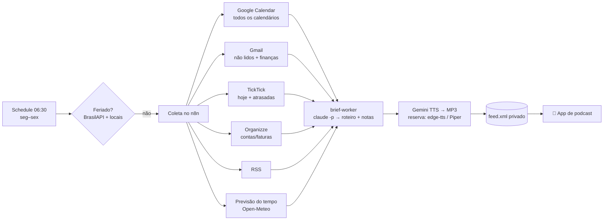

# Brief Matinal 🎧

Um **podcast pessoal e privado** gerado todo dia útil de manhã: previsão do tempo, agenda, tarefas, contas a pagar, e-mails que precisam de atenção, newsletters e notícias, num episódio de menos de 10 minutos para ouvir no carro.

- **Orquestração:** [n8n](https://n8n.io) busca os dados.
- **Roteiro:** [Claude Code](https://docs.claude.com/en/docs/claude-code) em modo headless escreve o texto com um token de longa duração da sua assinatura Claude, sem API paga.
- **Voz:** [Gemini TTS](https://ai.google.dev/gemini-api/docs/speech-generation) (chave grátis do Google AI Studio), muito mais natural. Se a cota acabar, cai para [edge-tts](https://github.com/rany2/edge-tts) e, em último caso, para [Piper](https://github.com/rhasspy/piper) local.
- **Entrega:** um feed RSS de podcast que só você conhece.



## Como funciona

| Etapa | Onde | Detalhe |
|---|---|---|
| Agendamento | n8n | Cron `30 6 * * 1-5`. Pula feriados nacionais (BrasilAPI), feriados locais e folgas configuráveis. |
| "Só o que é novo" | worker | O corte é o horário do último episódio. As notas da edição anterior vão no prompt para não repetir nada. |
| Coleta | n8n | Cada fonte tem `continueOnError`. Se uma falhar, o brief sai sem ela e avisa no áudio. |
| Newsletters sem RSS | Claude | O Claude usa `WebFetch`/`WebSearch` para achar a edição mais recente. |
| Roteiro | worker | `claude -p --json-schema` devolve `title`, `script` (falado), `notes_html` (com links) e `summary`. |
| Áudio | worker | Gemini TTS (`gemini-3.8-flash-tts`, voz `Charon`), em blocos de ~4.500 caracteres. Se falhar, usa edge-tts (`pt-BR-AntonioNeural`) e depois Piper (`pt_BR-faber-medium`). |
| Entrega | worker | `https://SEU-DOMINIO/<FEED_TOKEN>/feed.xml` com `itunes:block` e `noindex`. Guarda os últimos 10 episódios. |

Os links das notícias ficam nas **notas do episódio**, que o app de podcast mostra. O áudio não lê URLs.

## Estrutura

```
brief-worker/          serviço HTTP (Python/aiohttp) que roda claude + TTS e serve o feed
  server.py            API: GET /api/state, POST /api/brief; feed: /<token>/feed.xml
  prompt.example.md    prompt genérico (crie um prompt.md, que é ignorado pelo git, para o seu)
  Dockerfile           python + ffmpeg + edge-tts + piper + Claude Code
  docker-compose.yaml
  .env.example
n8n/
  brief-matinal.json   workflow para importar no n8n
```

## Pré-requisitos

- n8n self-hosted em Docker. O worker entra na mesma rede Docker do n8n.
- Assinatura Claude (Pro/Max) para o `claude setup-token`.
- Um domínio ou subdomínio com HTTPS apontando para o worker, para o app de podcast baixar o feed.
- Opcional: Google (Gmail/Calendar), TickTick e Organizze.

## Passo a passo

### 1. Subir o worker

```bash
git clone https://github.com/<voce>/daily-brief && cd daily-brief/brief-worker
cp .env.example .env
# gere os segredos:
sed -i "s/^WORKER_TOKEN=.*/WORKER_TOKEN=$(openssl rand -hex 24)/; s/^FEED_TOKEN=.*/FEED_TOKEN=$(openssl rand -hex 16)/" .env
chmod 600 .env
```

Edite o `.env`:

- `PUBLIC_BASE_URL`: o seu domínio, por exemplo `https://brief.seudominio.com`.
- `N8N_NETWORK`: a rede Docker do n8n. Veja com `docker network ls`.
- `BRIEF_OWNER` e `BRIEF_CITY`: usados no prompt genérico.

### 2. Token do Claude (sem API paga)

Numa máquina com o Claude Code logado:

```bash
claude setup-token
```

Cole o token em `CLAUDE_CODE_OAUTH_TOKEN=` no `.env` e suba o worker:

```bash
docker compose up -d --build
docker exec <container-do-n8n> wget -qO- http://brief-worker:8080/health   # {"ok": true, "claude": true}
```

> O uso conta na cota da sua assinatura. Um brief por dia é pouco: dá ~1–2 min de processamento.

### 2b. Voz natural com Gemini (opcional, recomendado)

Gere uma chave grátis em [aistudio.google.com/apikey](https://aistudio.google.com/apikey) e coloque em `GEMINI_API_KEY=` no `.env`. Sem a chave, o worker usa o edge-tts. O plano grátis tem limite diário de requisições: um episódio usa de 2 a 3. Se o limite estourar, o worker cai para o edge-tts automaticamente.

### 3. Expor o feed com HTTPS

Aponte um subdomínio para a porta `8093` do host, usando Nginx Proxy Manager, Caddy, Traefik, Cloudflare Tunnel ou o que você já usa. Só o feed (`/<FEED_TOKEN>/...`) e as páginas `/` e `/privacidade` são públicos. A API exige `Authorization: Bearer <WORKER_TOKEN>`.

As páginas `/` e `/privacidade` existem porque o Google pede essas URLs para colocar o app OAuth em produção (passo 5).

Se o host tiver firewall, libere a porta só para a rede interna do proxy, por exemplo:

```bash
sudo iptables -I INPUT <pos> -s 10.0.0.0/24 -p tcp --dport 8093 -j ACCEPT && sudo netfilter-persistent save
```

### 4. Importar o workflow no n8n

**Workflows → Import from file → `n8n/brief-matinal.json`**. Depois:

1. Crie uma credencial **Header Auth** chamada `Brief Worker`, com Name `Authorization` e Value `Bearer <WORKER_TOKEN>`. Use-a nos nós *Último brief (worker)* e *Gerar episódio (worker)*.
2. Ajuste os nós de **Code**:
   - **Calendário útil (feriados):** `FERIADOS_LOCAIS_FIXOS`, `FOLGAS_EXTRAS`, `CARNAVAL_E_FERIADO` e `CINZAS_E_FERIADO`.
   - **Lista de feeds RSS:** suas fontes.
   - **Previsão do tempo (Open-Meteo):** `latitude` e `longitude` da sua cidade (grátis, sem chave). Ajuste também o `local` em *Montar dados do brief*.
   - **Montar dados do brief:** a lista `newsletters_web`, com as newsletters que o Claude deve buscar na web.
3. No nó **Gmail: análises financeiras**, troque `from:SEU-BANCO.com` pelo remetente dos e-mails de análise do seu banco ou corretora.

### 5. Credenciais Google (Gmail + Calendar)

1. No [Google Cloud Console](https://console.cloud.google.com), crie um projeto e ative a **Gmail API** e a **Google Calendar API**.
2. Em **Google Auth Platform**:
   - **Branding:** nome do app; página inicial `https://SEU-DOMINIO/`; política de privacidade `https://SEU-DOMINIO/privacidade`; domínio autorizado = o seu domínio. Não envie logo, senão o app precisa de verificação.
   - **Público:** Externo → **Publicar app (Em produção)**.
3. **Clientes → Criar cliente → Aplicativo da Web**, com o redirect `https://SEU-N8N/rest/oauth2-credential/callback`.
4. No n8n, crie as credenciais **Gmail OAuth2** e **Google Calendar OAuth2** com esse client e faça o login. Na tela "app não verificado", vá em *Avançado → Acessar*.

> ⚠️ Se o app ficar em modo **Teste**, o Google expira o token a cada 7 dias.

### 6. Credencial TickTick

1. Em [developer.ticktick.com](https://developer.ticktick.com), vá em **Manage Apps**, crie um app e use o mesmo redirect do n8n.
2. No n8n, crie uma credencial **OAuth2 API** chamada `TickTick OAuth2`:

| Campo | Valor |
|---|---|
| Grant Type | Authorization Code |
| Authorization URL | `https://ticktick.com/oauth/authorize` |
| Access Token URL | `https://ticktick.com/oauth/token` |
| Scope | `tasks:read` |
| Authentication | Header |

3. Clique em **Connect my account**.

### 7. Organizze (opcional)

O nó *Organizze: pagamentos (Postgres)* lê um espelho do Organizze em Postgres (schema `organizze.*`, com as tabelas `transactions`, `accounts`, `categories`, `credit_cards` e `credit_card_invoices`), sincronizado por outro workflow.

Se você não tem esse espelho, troque o nó por chamadas HTTP à [API do Organizze](https://github.com/organizze/api-doc) (`/transactions` e `/credit_cards/:id/invoices`), com Basic Auth, ou simplesmente desative o nó.

### 8. Testar e ativar

- **Teste:** rode o workflow pelo gatilho **Teste manual**. Ele ignora a checagem de dia útil e gera um episódio `[Teste]`, que **não conta** para o corte de novidade.
- **Ativação:** publique ou ative o workflow. Daí em diante ele roda sozinho às 06:30 nos dias úteis.

### 9. Assinar o podcast

Use `https://SEU-DOMINIO/<FEED_TOKEN>/feed.xml`. Trate essa URL como uma senha.

Prefira um app que baixe o feed direto do celular, como o **AntennaPod** (*Adicionar podcast → por URL*). Pocket Casts, Overcast e Apple Podcasts buscam o feed pelos servidores deles. Ligue o download automático no Wi-Fi para o episódio já estar no celular quando você sair.

## Personalização

| O que | Onde |
|---|---|
| Tom, seções, duração, regras de negócio | `brief-worker/prompt.md` (copie de `prompt.example.md`) |
| Voz principal | `GEMINI_TTS_VOICE` (Charon, Puck, Kore, Sulafat, Aoede…), `GEMINI_TTS_MODEL` e `GEMINI_TTS_STYLE` (instrução de estilo) no `.env` |
| Voz de reserva | `TTS_VOICE` e `TTS_RATE` (edge-tts). Liste as vozes com `docker exec brief-worker edge-tts --list-voices \| grep pt-BR`. |
| Modelo | `CLAUDE_MODEL` (`sonnet`, `opus`, …) |
| Episódios guardados | `KEEP_EPISODES` |
| Capas | Geradas automaticamente (podcast + uma por episódio com a data), em Inter/Fira Code. `ARTWORK_BRAND` põe um texto no canto (ex.: seu domínio). Cores e layout em `render_artwork()` no `server.py`. |
| Horário | gatilho *Dias úteis 06:30* no n8n |

## Problemas comuns

| Sintoma | Causa e solução |
|---|---|
| Episódio saiu com `tts: edge-tts` em vez de `gemini` | Veja `docker logs brief-worker \| grep gemini`. Costuma ser cota do plano grátis (429) ou chave inválida. |
| `edge-tts` 403 / `WSServerHandshakeError` | A Microsoft mudou o handshake. Rode `docker compose build --no-cache && docker compose up -d` para pegar a versão nova (o Piper cobre enquanto isso). |
| TickTick: `Unable to sign without access token` | A credencial foi criada mas o OAuth não foi concluído. Clique em *Connect my account*. |
| Google pede novo login toda semana | O app OAuth está em modo Teste. Publique em produção (passo 5). |
| Workflow não ativa: `Missing required credential` | Crie a credencial ou desative temporariamente o nó. |
| Episódio sem newsletters | Veja `num_turns` na resposta do worker. O prompt exige `WebFetch`/`WebSearch` para cada uma. |

## Segurança

- O feed é protegido por um token aleatório na URL ("capability URL"), e não por login. Não compartilhe a URL.
- A API do worker exige um Bearer token. Os dados enviados pelo n8n ficam só no seu servidor (últimos N episódios).
- O conteúdo de e-mails e notícias é tratado como dado, não como instrução, no prompt.
- `.env` e `prompt.md` estão no `.gitignore`.

## Licença

[MIT](LICENSE)
